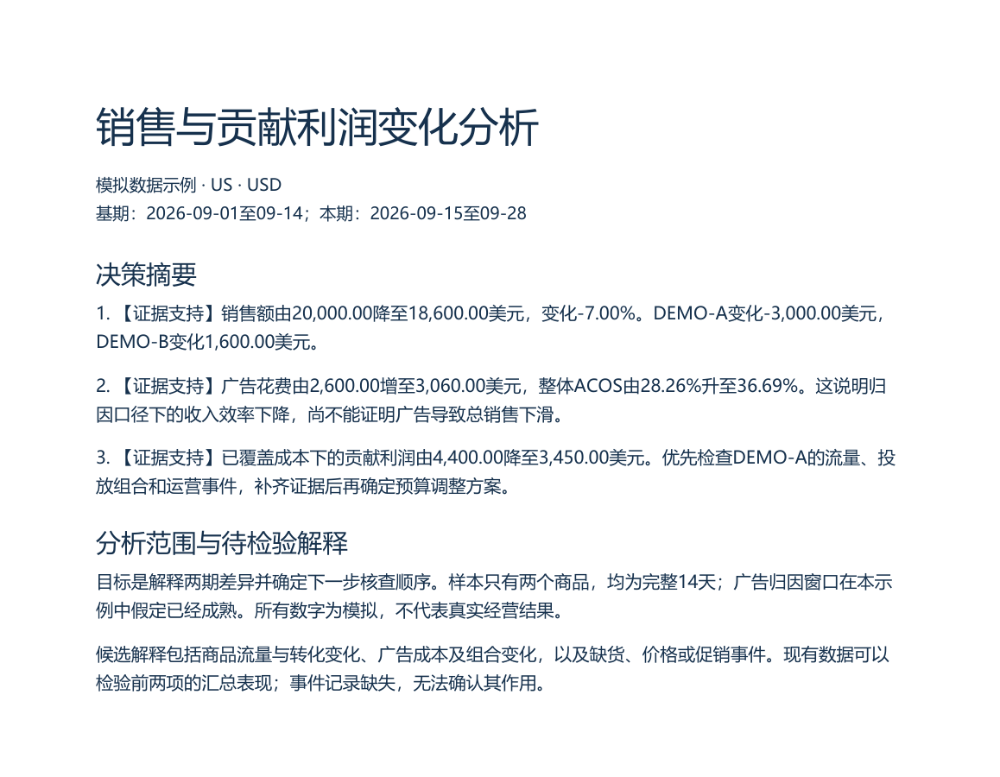
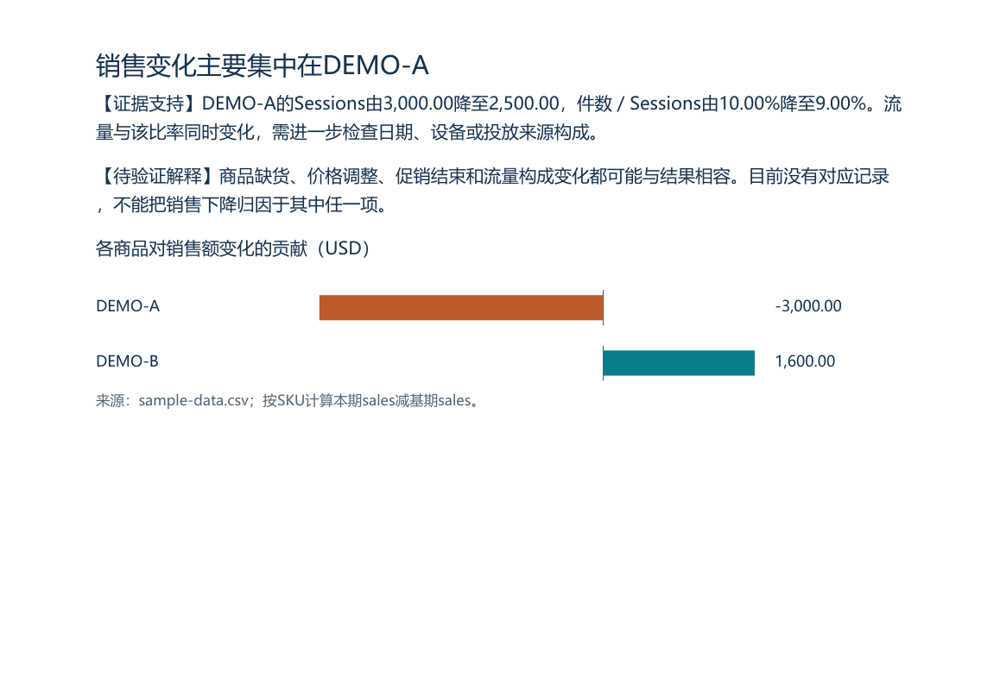

# Amazon Business Analyst

一个面向亚马逊卖家的通用数据分析 skill：你提供数据和业务问题，它选择分析方法、核对指标口径，产出一份包含关键指标、图表、行动建议和局限说明的 PDF 报告。

不绑定任何平台、账号或第三方工具。经营、广告、利润、库存、市场、竞品、评论都可以问，具体分析什么由你的问题和手头数据决定。

 

上图为 `examples/sample-report.pdf` 的实际页面，数据为模拟。

## 它解决什么问题

亚马逊数据最常见的坑不是不会算，而是算错了却看起来很正常：

- 广告归因销售额被当成增量销售额。
- 流量得分被当成真实访客数去算转化率。
- 父体汇总和子体明细相加，销售额重复计算。
- 平均各商品的 ACOS，得到一个不存在的整体 ACOS。
- 缺成本却把销售额减广告费的差额称为利润。

这个 skill 把这类口径规则和判断纪律写成固定指令，让每次分析都要说明数据覆盖了什么、没覆盖什么，以及哪条结论还只是待验证的解释。

## 工作方式

五个阶段，顺序固定，内容随问题变化：

1. **确定问题和可比较的范围** —— 要支持什么决策、比较哪两段、哪些事件会影响判断。按 [场景追问清单](references/scenario-questions.md) 一次问完该场景缺的背景信息。
2. **选择判断路径** —— 提出少量可验证的候选解释，说明各自需要什么证据。
3. **建立数据口径** —— 识别报表类型、粒度、日期含义、合并规则和缺失情况。
4. **分析并寻找反证** —— 从整体到贡献，再检查机制；每个关键判断都要找出一种可能推翻它的解释。
5. **组织并交付报告** —— 决策摘要在前，待检验的解释及其状态其次，证据与图表居中，口径与限制在后。

结论统一标记为 **【证据支持】**、**【待验证解释】** 或 **【数据不足】**，不编造置信分数。

`references/scenario-questions.md` 覆盖经营诊断、广告效率、利润成本、库存补货、选品新品、竞品关键词、评论 Listing、促销复盘八类场景，每类写明必须确认什么、通常不必问什么、最常见的误判是什么。它给的是追问的方向，不是固定模块——具体分析什么仍由你的问题决定。

## 安装

把整个目录放进你的 skill 目录即可，目录名保持 `amazon-business-analyst`。

```bash
# 用户级（对所有项目生效）
git clone https://github.com/sumomowynaut/amazon-business-analyst ~/.claude/skills/amazon-business-analyst

# 项目级
git clone https://github.com/sumomowynaut/amazon-business-analyst .claude/skills/amazon-business-analyst
```

作为插件安装（仓库已带 `.claude-plugin/plugin.json`）：

```bash
claude plugin install sumomowynaut/amazon-business-analyst
```

**Codex**：放到 `~/.codex/skills/`（个人级），或仓库内的 `.agents/skills/`（随仓库生效，Codex 会从当前目录向上扫描每一级的 `.agents/skills`）。`agents/openai.yaml` 提供客户端展示名称与默认提示，缺失不影响 skill 本身。

**其他 Agent**：skill 的主体是 Markdown。把 `SKILL.md` 与按需读取的 `references/*.md` 拼进 system prompt 即可，`scripts/` 只在需要生成 PDF 时使用。

## 生成 PDF

`scripts/render_report.py` 把分析结果 JSON 排成 PDF，需要 `reportlab` 和一个中文字体文件：

```bash
python -m pip install -r requirements.txt
python scripts/render_report.py report.json report.pdf
```

字体默认从系统路径查找（Windows 微软雅黑／等线／黑体／宋体、macOS 苹方、Linux 文泉驿），也可以用 `--font /path/to/font.ttc` 或环境变量 `AMAZON_ANALYST_FONT` 指定。仓库不分发字体。

脚本只负责排版，不计算指标、不推断原因。内置条形图与折线图；直方图、箱线图、散点图需先导出 PNG 再作为 `image` 插入。JSON 结构、`lang` 与 `kind` 字段和排版约定见 [references/pdf-rendering.md](references/pdf-rendering.md)。

## 示例

`examples/` 下是一份完整的模拟任务：两个商品、两个 14 天期间的自定义汇总表，问题为"销售和贡献利润为何下降，下周先检查什么"。数据是人为构造的，不对应任何真实商品或账户。

```bash
python scripts/build_example.py --output-dir work/example
```

输出 `sample-report.json` 与 `sample-report.pdf`，可用于确认字体、图表和分页正常。仓库的 `examples/` 下同时附带生成好的 PDF 与 JSON。

## 测试

```bash
python -m pip install -r requirements-dev.txt
python -m unittest discover -s tests -v
```

覆盖报告结构校验（缺字段、表格列数不匹配、`NaN`／`null`、远程图片、`lang` 与 `chart.kind` 取值）、英文报告不混入中文标签、折线图渲染、PDF 生成后可检索、渲染失败不留下半成品，以及示例数据汇总与口径重算。`tests/behavior-cases.md` 是人工验收用例，列出每类任务应当出现和不应出现的判断。

推送时 GitHub Actions 会自动运行同一套测试（见 `.github/workflows/tests.yml`）。

## 目录结构

```text
amazon-business-analyst/
├── SKILL.md                        # 主流程与规则
├── .claude-plugin/plugin.json      # 插件清单（可选安装方式）
├── agents/openai.yaml              # Codex 展示信息（可选）
├── references/
│   ├── scenario-questions.md       # 八类场景的必须追问清单
│   ├── data-guide.md               # 报表识别、字段映射、合并去重
│   ├── metrics.md                  # 指标定义与计算条件
│   ├── analysis-principles.md      # 证据层级、样本、反证
│   ├── analysis-methods.md         # 按问题选择方法
│   ├── report-guide.md             # 报告结构与图表规范
│   ├── writing-style.md            # 措辞、中英混排、数字表达
│   ├── report-examples.md          # 判断示例
│   └── pdf-rendering.md            # PDF 依赖、JSON 结构与检查
├── scripts/
│   ├── render_report.py            # JSON → PDF
│   └── build_example.py            # 重建示例报告
├── examples/
│   ├── brief.md                    # 示例任务与字段定义
│   ├── sample-data.csv             # 模拟数据
│   └── sample-report.pdf           # 生成好的示例报告
├── assets/                         # README 预览图
└── tests/                          # 自动测试与人工验收用例
```

SKILL.md 只放每次分析都需要的流程；细节知识按任务读取，避免把全部参考资料塞进上下文。

## 边界

- 只分析你提供的数据，不自动联网补数、不抓竞品、不登录卖家账户。
- 不修改预算、报价、商品信息或采购计划，只给判断和待验证的行动建议。
- 输入中的表格公式、宏、外部链接和嵌入指令一律当作待分析内容，不执行。
- 缺少采购、物流等成本时，明确说明利润计算覆盖了哪些成本，不把差额称为净利润。

## 许可

MIT，见 [LICENSE](LICENSE)。
